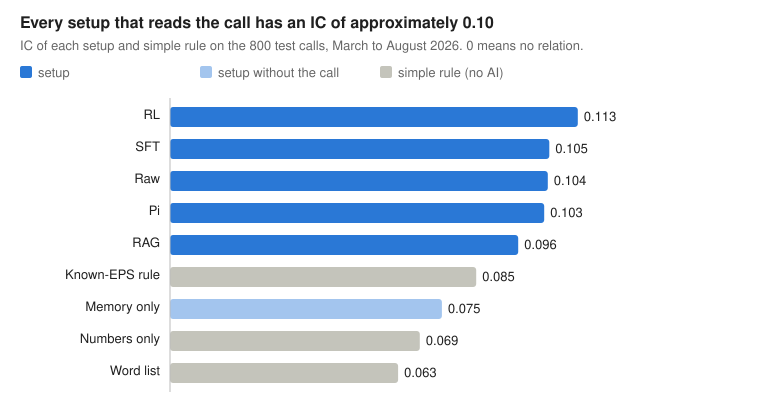

# Earnings-call distillation

Can a small model that runs on a laptop learn to read company earnings calls well enough to pick stocks, by learning from a large one?

This repo holds the code, data and results of a week-long experiment that tested it:

- **Student:** Qwen3.5-9B (4-bit, MLX) on a MacBook Pro.
- **Teacher:** Claude Opus.
- **Calls:** smaller US companies.
- **Test:** 800 calls from March to August 2026, after the model's release, sealed until the final scoring step.

**Read the write-up:** [It Sounds Like the Teacher but Doesn't Trade Like It](blog/2026-11-small-model-earnings-calls/README.md). It walks through one real call from prompt to outcome, the training data and how every number is calculated.

**See the real inputs and outputs:** [`examples/README.md`](examples/README.md) lists every experiment and test, each with 10 real calls: the exact prompts, the answers, the training targets or rewards, and the outcomes. [`data/paper/training/`](data/paper/training) has the full training data.

## What we found



- Every AI setup ranked stocks at about 0.10 (rank correlation with 60-day sector-adjusted returns). No step beat the one before it by more than noise:
    - adding documents (RAG)
    - letting the model search (pi)
    - fine-tuning on Opus's answers (SFT)
    - reinforcement learning (RL)
- Training made the student read calls more like Opus (66% → 71% agreement) and forecast earnings slightly better, but it didn't rank stocks better. Controls trained on shuffled labels and shuffled rewards did as well as the real thing.
- The model's BUY decision does follow its stated read: forcing "Demand: up" instead of "down" raised it on 199–200 of 200 calls.
- When the 9B chose its own documents, its earnings forecasts got worse. The same agent loop given RAG's documents was fine.

## Reproduce it

There are three levels, from a minute on any laptop to a week on an Apple Silicon Mac.

| Level | What it reproduces | Needs | Time |
| --- | --- | --- | --- |
| **1. Re-score** | The exact published tables, from the published per-call model outputs | macOS or Linux, Python 3.10+ | 1 minute |
| **2. Rebuild the data** | Every dataset, the fixed sets and the knowledge base, from the public source tables | Apple Silicon Mac, about 6 GB of disk | A few hours |
| **2b. Rerun the trained models** | The SFT and RL test reads, from the published adapters, without retraining | Level 2 done | About 7 hours |
| **3. Rerun a stage** | Every read, training run, agent run and score | Apple Silicon Mac with 18 GB+, Node 22.19+ | About 1 day (mini) or 6 days (week) |

**Level 1**

```bash
pip install -r requirements-rescore.txt
bash reproduce/rescore.sh          # prints OK for results.csv, findings.csv and faithfulness.csv
```

**Levels 2 and 3**

```bash
bash reproduce/setup.sh            # Python env, pinned 9B model, pi agent
bash reproduce/download_data.sh    # 2.9 GB of source tables from Hugging Face, checked against our hashes
bash reproduce/build_data.sh       # datasets + knowledge base; reports whether the sets match ours
bash reproduce/rerun_trained_reads.sh   # optional: SFT and RL test reads with the published adapters
bash reproduce/run_stage.sh week   # or: mini
```

Level 3 costs nothing in API fees by default, because every Opus answer the run used is in the repo and the teacher step skips calls that already have one. To ask Opus afresh, move `data/paper/teacher/labels_v2.jsonl` aside and put an API key in `.env` (about $37 for the week stage). Opus answers and GPU training are not bit-for-bit deterministic, so Level 3 reproduces the procedure rather than every digit.

## What's here

```
blog/                       the write-up, its figures and tidy result tables
examples/                   10 real calls for every experiment and test: prompts, answers, targets, rewards, outcomes
reproduce/                  the scripts for the three levels
docs/DATA.md                every data file: source, license, columns
docs/SCRIPTS.md             every script: what it reads and writes, and the run order
docs/FIXES.md               what broke during the runs and how it was fixed
scripts/paper/              the pipeline: data, knowledge base, reads, agent, teacher, training, scoring
scripts/*.py, src/tagent/   helpers from the project's earlier studies that the pipeline imports
configs/paper/              the step list, per-stage commands and the frozen-set hashes
tools/pi/                   the pi agent's search tools, sandbox profile and pinned package
data/                       source tables small enough to share, and everything we built from them
runs/paper/{mini,week}/     every model output, training curve and log from the two runs
adapters/paper/week/        LoRA weights of the SFT and RL models scored on the test
```

## Data and models

- **Source data:** [defeatbeta/yahoo-finance-data](https://huggingface.co/datasets/defeatbeta/yahoo-finance-data) (ODC-BY) on Hugging Face. The small tables are in `data/raw/`. The transcripts, prices and statements (2.9 GB) are downloaded by `reproduce/download_data.sh`.
- **SPY bars:** from Yahoo Finance via yfinance, in `data/raw/daily_bars.parquet`.
- **Student model:** [mlx-community/Qwen3.5-9B-4bit](https://huggingface.co/mlx-community/Qwen3.5-9B-4bit), pinned to revision `8b2b98c`.
- **Teacher:** Claude Opus (`claude-opus-5-5`) through the Anthropic Batch API. All 2,200 of its answers are in `data/paper/teacher/labels_v2.jsonl`.
- **Agent:** [pi](https://github.com/earendil-works/pi), pinned in `tools/pi/package-lock.json`.

Everything we created is included: the call sets and their hashes, features, outcomes, Opus labels, the analyst handbook, every per-call model output, the training curves and the logs. Four things are left out:

- **Transcript text** and anything holding it: the knowledge base, and the retrieved passages in the agent logs. It isn't ours to redistribute, and the scripts rebuild it from the source.
- **Most trained adapters.** Only the two scored on the test are here: `adapters/paper/week/sft_grown` (SFT) and `adapters/paper/week/trade` (RL), 43 MB of LoRA weights each. The other arms and the optimizer states (about 3 GB) are left out, and `run_stage.sh` retrains them.
- **The sealed final test part** (Test-F, 1,757 calls). Its outcomes, and every row of it in the run outputs, stay out until a full run scores it.
- **One limit on exactness:** the source dataset changes daily, and its history was compacted on 2026-11-13, so the exact snapshot used here can't be downloaded any more. `reproduce/check_sources.py` and `build_data.sh` show whether your copy still rebuilds the same sets.

See [docs/DATA.md](docs/DATA.md) for every file and column.
