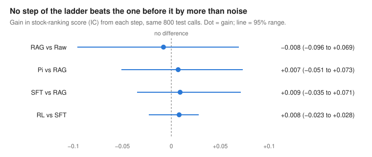

# It Sounds Like the Teacher but Doesn't Trade Like It

*Nityanand Rai · November 13, 2026*

*I tried to teach a small AI model to read company earnings calls like a large model. The small model runs on my laptop. The large model is Claude Opus. After training, the small model wrote answers that looked more like Opus's answers. But it did not pick better stocks.*

*This post shows what the small model read, what it wrote, how I trained it, and how I calculated each number. Each section links to the real files in the [repo](https://github.com/nityarai08/earnings-call-distillation).*

## The short version

- I compared six setups of one small model, Qwen3.5-9B, on 800 earnings calls that it had never seen.
- All six setups ranked stocks a little better than chance. Their IC values (a measure of ranking quality) were all close to 0.10.
- No setup was better than the others by more than chance can explain.
- Training on Opus's answers made the small model agree with Opus more often: 66% for Raw, 71% after RL.
- About half of that gain came from one habit. The small model learned to call management "direct" almost every time, as Opus does.
- The training did not improve stock picking by more than chance. On validation calls, a control model that I trained on shuffled Opus answers ranked stocks about as well.
- The small model's BUY decision follows its own read lines. So the weak part is the quality of the read lines.

---

## Words used in this post

| Word | Meaning in this post |
| --- | --- |
| **Call** | One quarterly earnings call of one company |
| **Small model** | Qwen3.5-9B, an open model with 9 billion parameters (numbers that the model learned), compressed to 4 bits so that it runs on a laptop |
| **Opus** | Claude Opus, the large model that I used as the teacher |
| **Answer** | The seven lines that a model writes for one call (shown in section 3) |
| **Read lines** | The first five lines of an answer: Demand, Pricing, Margins, Guidance and Candor |
| **Managers' replies** | The managers' answers to the analysts' questions, from the transcript of the call. The prompt calls this part "Management's answers" |
| **p(BUY)** | The probability of BUY divided by the sum of the probabilities of BUY and AVOID. This is the stock score |
| **Setup** | One way to use the small model. There are six setups (section 3) |
| **Control** | A setup that I broke on purpose. If a control scores as well as the real setup, the real setup's gain is not real |
| **Library** | A searchable store of past calls, company figures and analyst notes |
| **Knowledge block** | The part of the library that a setup adds to the prompt, up to 1,500 tokens |
| **Adapter** | A small set of extra weights that training adds to the small model. The original weights do not change |
| **Outcome y** | How well a stock did after a call, compared with its sector (section 3) |
| **IC** | Information coefficient: how well a list sorted by p(BUY) matches a list sorted by outcome y (section 5) |
| **Step** | A change from one setup to the next: Raw to RAG, RAG to Pi, RAG to SFT, and SFT to RL |
| **Simple rule** | A method that ranks stocks without AI (section 6) |
| **Daily volatility** | The usual daily price change of a stock. The prompt calls it "daily risk" |
| **Session** | One trading day |
| **Token** | A word or a part of a word. 1,000 tokens are approximately 750 words |
| **Test set** | 800 calls from March to August 2026. Nobody looked at their outcomes until the final step |

## 1. The question

Opus reads an earnings call well. But it costs money to run Opus on thousands of calls. The small model runs free on a laptop, but it reads less well.

My question was: **can the small model learn from Opus to read calls well enough to pick stocks?**

I also tested four usual methods, one at a time:

1. Add documents from a library to the prompt.
2. Let the model search the library itself.
3. Train the model on Opus's answers.
4. Train the model further with rewards.

I also ran controls (see "Control" in the table above), so that a lucky result cannot look like a real gain.

## 2. The data

**Calls.** In an earnings call, the managers of a company talk about the last quarter, and analysts ask them questions. I used call transcripts from the public dataset [defeatbeta/yahoo-finance-data](https://huggingface.co/datasets/defeatbeta/yahoo-finance-data).

**Companies.** I used only smaller US companies. A call stayed in the data only if all of these were true:

- The stock's dollar trading volume (closing price × shares traded) was between $1M and $50M a day. I used the median day of the 60 trading days before the call.
- The share price was $3 or more.
- The managers' replies had 300 words or more, and the analysts' questions had 100 words or more.

This filter kept 59,753 calls from 2016 to 2026 ([calls.parquet](https://github.com/nityarai08/earnings-call-distillation/blob/main/data/paper/calls.parquet)).

**Masking.** Before a model reads a call, a script replaces the company name, the ticker and the years. Other names, for example project names, stay in the text. Thus a person or a model with wide knowledge can sometimes identify the company.

**Sets.** Before I ran any model, a script put each call into one set. The script recorded the sets and their checksums in [freeze.json](https://github.com/nityarai08/earnings-call-distillation/blob/main/configs/paper/freeze.json).

| Set | Calls in set | Calls I used | Dates | Purpose |
| --- | --- | --- | --- | --- |
| SFT training | 3,000 | 800 | 2021 to 2024, even quarters | Train on Opus's answers |
| RL training | 800 | 400 | 2021 to 2024, odd quarters | Train with rewards |
| Validation | 3,000 | up to 500 | 2025 | Compare setups during development |
| Check | 1,000 | 300 | 2023 to 2024 | Compare the small model's read lines with Opus's read lines |
| **Test set** | **800** | **800** | **March to August 2026** | **The final test in this post** |
| Second test set | 1,757 | 0 | March to August 2026 | Other calls from the same months, kept sealed for a larger run later |

**Why the test is fair.** Qwen released the small model in February 2026. Thus it cannot know what happened to these stocks after March 2026. The test outcomes stayed in a separate sealed file. Only the final scoring script opened that file, and only after all other steps were complete. The outcomes of the second test set are still closed.

## 3. One test call, from input to outcome

This section follows one real call from the test set. I did not choose it for its result. It is the first call in the test set's fixed random order. All its files are in [examples/1_test_call](https://github.com/nityarai08/earnings-call-distillation/tree/main/examples/1_test_call).

### The prompt

All setups use the same prompt layout. Below is a shortened copy of the prompt that the RAG setup read. The [full prompt](https://github.com/nityarai08/earnings-call-distillation/blob/main/examples/1_test_call/prompt_rag.txt) has 4,511 tokens.

```
[system] You are an experienced stock analyst. The company's name is masked. Use only what is below.

[user]
Facts: sector Industrials; daily dollar volume $5M to $20M; past 60-session return -15%;
daily risk 2.0%; move around the call -1.4%; EPS up 0.95 on a year ago; position none.

Knowledge: This company, earlier call: Regarding oil, currently, we don't have any land to
significantly increase production. ... [2 earlier calls of this company]
Similar past call: ... we are in for a good sustained boom ... Then lagged its sector, and
next-quarter EPS fell on a year ago. [3 other companies' calls, each with what happened next]
Company figures: ... Analyst note: ...

Management's answers:
Great. So let's go to the next question. ... How are the royalties settled? Are they include
in the hedge? ... No, royalties do not have any connection to the hedging. ... [up to 2,500 words]

Reply with exactly these seven lines, choosing one value from each list and writing nothing else.
Demand: up, flat or down (over the next two quarters)
Pricing: up, flat or down (over the next two quarters)
Margins: up, flat or down (over the next two quarters)
Guidance: raised, held, cut or none (what management did)
Candor: direct or evasive (how they answered)
Next EPS: up or down (next quarter's EPS against a year earlier)
Action: BUY or AVOID (for the next 60 sessions)

[assistant] Demand:
```

The prompt has four parts:

1. **Facts.** One line of numbers that a trader could see on the day of the decision. The numbers are:
    - the stock's trading volume
    - its return over the last 60 trading days
    - its daily volatility, which the prompt calls "daily risk"
    - its price change around the call
    - the change in its last earnings per share (EPS).
2. **Knowledge.** The knowledge block from the library. In the RAG setup it contains:
    - two earlier calls of the same company
    - three similar calls of other companies, each with a note about how that stock did after its call
    - the company's recent figures
    - one general analyst note.

    The library returns only material dated before the decision.
3. **Managers' replies.** The managers' replies from the question-and-answer part of the call, masked and cut at 2,500 words.
4. **The instruction.** The seven lines that the model must complete.

### The six setups

The six setups differ only in the knowledge block, the managers' replies and the model weights. All setups get the facts line.

| Setup | What it means | Knowledge block | Managers' replies | Model |
| --- | --- | --- | --- | --- |
| Memory only | The model sees the facts line but not the call | none | not given ([prompt](https://github.com/nityarai08/earnings-call-distillation/blob/main/examples/1_test_call/prompt_memory.txt)) | small model |
| Raw | The model reads the call with no help | none | given ([prompt](https://github.com/nityarai08/earnings-call-distillation/blob/main/examples/1_test_call/prompt_raw.txt)) | small model |
| RAG | A fixed search adds documents ("retrieval-augmented generation") | from a fixed search | given ([prompt](https://github.com/nityarai08/earnings-call-distillation/blob/main/examples/1_test_call/prompt_rag.txt)) | small model |
| Pi | The model searches the library itself, with the pi agent tool | from the model's own searches | given ([prompt](https://github.com/nityarai08/earnings-call-distillation/blob/main/examples/1_test_call/prompt_pi.txt)) | small model |
| SFT | RAG, after training on Opus's answers ("supervised fine-tuning") | from a fixed search | given | small model + [SFT adapter](https://github.com/nityarai08/earnings-call-distillation/tree/main/adapters/paper/week/sft_grown) |
| RL | SFT, after more training with rewards ("reinforcement learning") | from a fixed search | given | small model + [RL adapter](https://github.com/nityarai08/earnings-call-distillation/tree/main/adapters/paper/week/trade) |

In the Pi setup, the model first uses two tools. The tool `kb_search` searches the library, and the tool `kb_read` opens one document. On average, the model made about 4 searches or reads for each earnings call and kept about 2 documents. These documents became its knowledge block.

### How I get numbers from an answer

The model does not write free text. At each line, I take the probability that the model gives to each allowed value. Then I keep the most probable value and go to the next line. From each answer I keep two numbers:

- **p(Next EPS up):** the probability that next quarter's EPS is higher than a year earlier.
- **p(BUY):** the probability of BUY, compared with AVOID. **This is the stock score.**

### The answers of the six setups

The data comes from [answers.csv](https://github.com/nityarai08/earnings-call-distillation/blob/main/examples/1_test_call/answers.csv).

| Setup | Demand | Pricing | Margins | Guidance | Candor | p(Next EPS up) | p(BUY) | Action |
| --- | --- | --- | --- | --- | --- | --- | --- | --- |
| Memory only | down | flat | flat | none | evasive | 0.47 | 0.00 | AVOID |
| Raw | flat | flat | up | none | evasive | 0.62 | 0.20 | AVOID |
| RAG | up | flat | up | none | direct | 0.41 | 0.03 | AVOID |
| Pi | flat | flat | up | none | evasive | 0.87 | 0.08 | AVOID |
| SFT | up | flat | up | none | direct | 0.68 | 0.69 | BUY |
| RL | up | flat | up | none | direct | 0.66 | 0.67 | BUY |

### What happened to the stock

The data comes from [outcome.json](https://github.com/nityarai08/earnings-call-distillation/blob/main/examples/1_test_call/outcome.json). The timeline of the trade is:

1. The call was on 2026-03-03.
2. The model decides at the close of the next trading day, 2026-03-04.
3. The trade buys at the next opening price.
4. The trade sells at the close 60 trading days after the decision, on 2026-05-29.

| Step | Value |
| --- | --- |
| Return of the stock over the 60 trading days, with dividends | +11.3% |
| Average return of the stocks in the same sector | +9.8% |
| **Excess return** = 11.3% − 9.8% | **+1.5%** |
| Daily volatility of the stock | 1.96% |
| **Outcome y** = excess return ÷ (daily volatility × √60) = 0.0149 ÷ (0.0196 × 7.75) | **+0.098** |
| Next quarter's EPS minus the EPS a year earlier | +0.98, which is **up** |

The stock did slightly better than its sector, and its EPS went up. SFT and RL said BUY, so they were right on this call. The other four setups said AVOID. Raw, Pi, SFT and RL forecast EPS up, which was also right. One call proves nothing. Thus all measures below use all 800 test calls.

**Why I divide by volatility.** A 1.5% excess return is small for a stock that usually moves 5% in one day. It is large for a stock that usually moves 0.5%. Daily volatility × √60 is the usual price change over 60 trading days. Division by this number puts all stocks on the same scale.

## 4. How I trained the small model

### Opus's answers

Opus received the same prompt as the small model. Opus wrote the same seven lines. It also gave a rating from 0 (much worse than its sector) to 100 (much better), and up to three quotes from the call. Opus read each training call two times:

- one time with a neutral instruction
- one time with an instruction to be skeptical.

Here are the two Opus answers for the first training call ([opus_labels.jsonl](https://github.com/nityarai08/earnings-call-distillation/blob/main/examples/2_sft_training_call/opus_labels.jsonl)):

| Instruction | Demand | Pricing | Margins | Guidance | Candor | Next EPS | Rating |
| --- | --- | --- | --- | --- | --- | --- | --- |
| Neutral | up | flat | up | none | direct | up | 61 |
| Skeptical | up | flat | flat | none | direct | up | 58 |

Opus chose these quotes:

- *"For the first quarter, chassis shipments were at record levels."*
- *"the supply chain base for all of our products seems extremely strong"*
- *"with the strong demand for the carrier product, we plan to keep it dedicated on carrier production"*

The file [labels_v2.jsonl](https://github.com/nityarai08/earnings-call-distillation/blob/main/data/paper/teacher/labels_v2.jsonl) contains all 2,200 answers from Claude:

- 1,600 Opus answers for 800 training calls, with two instructions each
- 300 Opus answers for the check calls
- 300 answers from Claude Sonnet for the same check calls.

These answers cost approximately $37.

### Training on Opus's answers (SFT)

For each training call, a script makes one target ([target.json](https://github.com/nityarai08/earnings-call-distillation/blob/main/examples/2_sft_training_call/target.json)):

| Line | Target | Source |
| --- | --- | --- |
| Demand to Candor | up, flat, up, none, direct | Opus's neutral answer |
| Next EPS | up | **The real result**, not Opus's answer |
| Action | **BUY with probability 0.84** | Opus's mean rating (59.5), ranked against the other training calls of the same month |

The read lines come from Opus's neutral answer. The skeptical answer changes only the mean rating.

**How I get 0.84.** The training set has 40 calls in this month. The mean rating of 59.5 is in position 34 of 40, from lowest to highest. So its percentile rank is 34 ÷ 40 = 0.85. Then I subtract half a step, 0.5 ÷ 40 = 0.0125. The result is **0.8375**. The half step keeps each target away from exactly 0 and exactly 1. Thus the model learns to say BUY with 84% confidence, not 100%.

Below is the training text: the prompt, followed by the target answer ([training_text.txt](https://github.com/nityarai08/earnings-call-distillation/blob/main/examples/2_sft_training_call/training_text.txt)):

```
... (prompt as above) ...
[assistant] Demand: up
Pricing: flat
Margins: up
Guidance: none
Candor: direct
Next EPS: up
Action: BUY            ← trained toward 0.84 BUY / 0.16 AVOID
```

**The training loss.** At each of the seven lines, the loss compares the model's probabilities for the allowed values with the target. The loss is cross-entropy. Cross-entropy is small when the model gives a high probability to the target value. The loss uses only these seven positions. It ignores all other text.

**Training settings:**

- The adapter is a LoRA adapter of rank 16. Rank 16 sets the size of the adapter. Training changes only the adapter on the top 8 layers of the small model.
- Each update uses 4 calls.
- The first part uses 400 calls, two times each, at a learning rate of 1e-4. The learning rate sets the size of each change to the adapter.
- The second part continues with 400 more calls, two times each, at a learning rate of 3e-5.

The result is the [SFT adapter](https://github.com/nityarai08/earnings-call-distillation/tree/main/adapters/paper/week/sft_grown). The training curve is in [sft_grown.csv](https://github.com/nityarai08/earnings-call-distillation/blob/main/runs/paper/week/train/sft_grown.csv).

**Other SFT variants.** I trained five variants and compared them on the same 300 validation calls:

| Variant | Targets |
| --- | --- |
| Read + EPS (the variant that I kept) | Read lines, Next EPS and Action, as shown above |
| Score only | Action only |
| Read | Read lines and Action, but not Next EPS |
| Hard | Action = 1 if the stock really did better than the month's median outcome, otherwise 0 |
| **Placebo** (control) | The read lines and ratings from Opus, shuffled among the calls of the same month. Thus they do not match their call. Next EPS stays real |

### Training with rewards (RL)

RL starts from the SFT model and uses 400 different training calls. For each call, the training does these steps:

1. It makes the model write 4 different answers. The answers differ because the training adds randomness. A temperature of 0.8 sets the amount of randomness.
2. It gives each answer a reward.
3. It moves the read lines toward the best answer of the four.
4. It moves p(BUY) toward the value that the reward prefers. It also keeps the model close to the start model.

**The four rewards:**

| Reward | Formula | What it rewards |
| --- | --- | --- |
| Trade | p(BUY) × (reward if BUY) + p(AVOID) × 0 | BUY on stocks that then do better than the month's average |
| Business | log p(the real Next EPS) + log 2 | An EPS forecast that is right and confident. The reward is 0 at 50/50 |
| Both | Business ÷ 0.7 + Trade | Both of the above. The factor 1 ÷ 0.7 (approximately 1.4) gives the business reward more weight |
| **Shuffled** (control) | Trade, with outcomes shuffled among the calls of the same month | Nothing real |

**Example of the trade reward** ([reward.json](https://github.com/nityarai08/earnings-call-distillation/blob/main/examples/3_rl_training_call/reward.json)). This is the fifth RL call. I chose it because its outcome is clear.

| Step | Value |
| --- | --- |
| Outcome y of this stock | −0.240 |
| Mean outcome y of the RL calls in the same month | +0.558 |
| z = outcome y − month mean, limited to the range −3 to +3 | −0.798 |
| Trading cost in the same units = 0.8% ÷ (daily volatility × √60) = 0.008 ÷ 0.313 | 0.026 |
| **Reward if BUY** = z − cost | **−0.824** |
| Reward if AVOID | 0 |
| p(BUY) of the SFT model before RL | 0.25 |
| Expected reward = 0.25 × (−0.824) + 0.75 × 0 | −0.206 |
| **RL target for p(BUY)** = 0.25 × e^(−0.824) ÷ (0.25 × e^(−0.824) + 0.75) | **0.13** |

This stock did much worse than the month's average. Thus RL moves p(BUY) down from 0.25 to 0.13.

**Why this target formula.** The formula multiplies each probability by e^reward. Then it scales the probabilities so that their sum is 1. This target gives the highest expected reward for a model that must stay close to the start model. I first tried a standard RL method, policy gradient. That method always chose AVOID after some steps. Thus I used this exact formula.

Each reward got 100 updates (400 calls ÷ 4 calls per update). On the validation calls, the trade reward gave the best result. So it became the [RL adapter](https://github.com/nityarai08/earnings-call-distillation/tree/main/adapters/paper/week/trade). Its training curve is in [trade.csv](https://github.com/nityarai08/earnings-call-distillation/blob/main/runs/paper/week/train/trade.csv).

## 5. How I calculated each number

One script calculates all measures: [score.py](https://github.com/nityarai08/earnings-call-distillation/blob/main/scripts/paper/score.py). The script reads two inputs:

- the answers of each setup for each call, in [runs/paper/week/reads](https://github.com/nityarai08/earnings-call-distillation/tree/main/runs/paper/week/reads) (for example [rl_best_test.csv](https://github.com/nityarai08/earnings-call-distillation/blob/main/runs/paper/week/reads/rl_best_test.csv))
- the test outcomes, in [test_w.parquet](https://github.com/nityarai08/earnings-call-distillation/blob/main/data/paper/sealed/test_w.parquet).

### The IC

The IC shows whether stocks with a higher p(BUY) did better. The script calculates it in three steps:

1. **Rank in each month.** In each month, the script converts each p(BUY) into a percentile rank among that month's calls, from 0 to 1. It does the same for outcome y. Because of this step, a rise or fall of the whole market does not count as skill.
2. **Correlate.** The script calculates the usual correlation between the two rank columns, over all 800 calls.
3. **Read the result.** 1 means a perfect order. 0 means no relation. −1 means a reversed order.

Here is a small example with five calls in one month:

| Call | p(BUY) | Rank | Outcome y | Rank | Difference d | d² |
| --- | --- | --- | --- | --- | --- | --- |
| A | 0.80 | 1 | +0.6 | 1 | 0 | 0 |
| B | 0.60 | 2 | −0.2 | 4 | −2 | 4 |
| C | 0.50 | 3 | +0.3 | 2 | 1 | 1 |
| D | 0.30 | 4 | +0.1 | 3 | 1 | 1 |
| E | 0.10 | 5 | −0.5 | 5 | 0 | 0 |

For one month, this calculation gives the Spearman rank correlation:

```latex
IC = 1 - \frac{6 \sum d^2}{n(n^2 - 1)} = 1 - \frac{6 \times 6}{5 \times 24} = 0.70
```

**A real example.** The call in section 3 is one of 130 test calls in March 2026. Among them, its RL p(BUY) is at the 65th percentile. Its outcome y is at the 60th percentile. The two ranks agree a little. Over all 800 calls, the IC of RL is **0.113**.

Real ICs are much lower than 0.70. For a list of hundreds of stocks, an IC of 0.05 to 0.10 is already useful. Small advantages add up over many trades.

### The other measures

| Measure | Calculation | Value for RL on the test set |
| --- | --- | --- |
| **EPS IC** | The same as the IC, with p(Next EPS up) and the real EPS change. 743 of the 800 calls have an EPS change | 0.278 |
| **Stock accuracy** | The percentage of calls where "p(BUY) > 0.5" agrees with "the stock did better than its sector" | 53.6% |
| **EPS accuracy** | The percentage of calls where "p(Next EPS up) > 0.5" agrees with the real EPS direction | 64.2% |
| **Agreement with Opus** | For the 300 check calls, the percentage of read lines that have the same value as Opus's read lines | 70.6% |
| **Return after costs** | The mean excess return of the calls with p(BUY) > 0.5, minus a trading cost of 0.8% | 438 BUY calls with a mean of +1.86%. Result: **+1.06%** |

**Example of agreement with Opus.** For check call 62273, Opus wrote: Demand up, Pricing flat, Margins down, Guidance none, Candor direct. The Raw setup agreed on 3 of the 5 read lines. The SFT setup agreed on 2.

### When is one setup better than another?

To compare two setups, the script uses the same calls for both. It calculates the IC of each setup and takes the difference. Then it measures how much chance can change that difference:

1. The test covers 22 weeks. The script picks 22 weeks at random from them. The same week can occur more than one time.
2. It calculates the two ICs and their difference again, with only the calls from the picked weeks.
3. It does steps 1 and 2 2,000 times.
4. It keeps the middle 95% of the 2,000 differences. This is the 95% range.

The script picks whole weeks because calls in the same week share the same market news. If the 95% range includes zero, the two setups are **not distinguishable** with this number of calls.

### Does the action follow the read lines?

I used 200 validation calls. For each call, I ran the model two times:

- one time with the Demand line forced to "up"
- one time with the Demand line forced to "down".

Then I compared the two values of p(BUY). For the first of these 200 validation calls, the SFT model gave 0.27 with "up" and 0.22 with "down". Over all 200 calls, the mean was 0.54 with "up" and 0.31 with "down".

## 6. Results

On the 800 test calls, all six setups had an IC of approximately 0.10. Each step adds one method: Raw to RAG, RAG to Pi, RAG to SFT, and SFT to RL. No step gave a gain larger than chance can explain.


The call text helps a little. Memory only (0.075) and the simple rules (0.06 to 0.085) have lower ICs than the setups that read the call.

The simple rules do not use AI:

- **Known-EPS rule:** ranks the stocks by the last EPS change divided by the share price.
- **Word list:** ranks the stocks by the tone of the managers' answers. The tone comes from a fixed list of positive and negative words.
- **Numbers only:** a small decision-tree model that uses only the facts line. I fitted it on the training calls.



All four 95% ranges include zero. The RL range is the narrowest. But it also includes zero, so RL can be slightly worse or slightly better than SFT.

| Setup or rule | IC | EPS IC | EPS accuracy | Agreement with Opus | BUY calls | Return after costs |
| --- | --- | --- | --- | --- | --- | --- |
| Memory only | 0.075 | 0.253 | 64.5% | — | 229 | −0.17% |
| Raw | 0.104 | 0.236 | 58.4% | 65.8% | 302 | +0.36% |
| RAG | 0.096 | 0.229 | 56.1% | 67.3% | 276 | −0.38% |
| Pi | 0.104 | 0.179 | 56.0% | 67.3% | 280 | +0.72% |
| SFT | 0.105 | 0.262 | 64.9% | 69.9% | 483 | +0.50% |
| RL | 0.113 | 0.278 | 64.2% | 70.6% | 438 | +1.06% |
| Known-EPS rule | 0.085 | 0.244 | 66.5% | — | 381 | +0.94% |
| Word list | 0.063 | 0.055 | 51.7% | — | 400 | +1.42% |
| Numbers only | 0.069 | — | — | — | 397 | +0.58% |
| BUY on every call | — | — | — | — | 796 | −0.68% |

The full tables are in [results.csv](https://github.com/nityarai08/earnings-call-distillation/blob/main/runs/paper/week/results.csv) and [findings.csv](https://github.com/nityarai08/earnings-call-distillation/blob/main/runs/paper/week/findings.csv).

## 7. What I learned

### 1. The small model learned to sound like Opus, but not to trade like Opus

After training, the small model agreed with Opus more often: 66% for Raw, 71% for RL. Its EPS IC also increased, from 0.236 to 0.278. But each step changed the stock IC by less than chance can explain (section 6).

About half of the gain in agreement comes from one line, Candor:

- Opus writes "direct" for 95% of calls.
- After training, the small model writes "direct" for 98% of calls.
- Agreement on the Candor line increased from 82% to 94%.

Thus about half of the gain is a copy of Opus's most frequent Candor value. It is not a better read of the call.

The controls on 300 validation calls from 2025 show the same result:

- **Placebo.** I trained this model on Opus answers that did not match their calls. The model never chose BUY, because its p(BUY) stayed below 0.5. But the IC uses only the order of p(BUY), so the model still had an IC of 0.099. RAG had 0.094 on the same validation calls. The best real SFT variant had an IC only 0.04 higher, with a 95% range of −0.07 to +0.17.
- **Shuffled reward.** RL with the real trade reward had an IC of 0.109. RL with the shuffled reward had an IC of 0.102.

Training on noise gave approximately the same result as training on real data.

### 2. The action follows the read lines

When I changed the Demand line from "down" to "up", the SFT model's p(BUY) increased from 0.31 to 0.54. It increased for all 200 calls. After RL, the mean increase was 0.21, and p(BUY) increased for 199 of 200 calls. Thus the model does not ignore its own read lines.

The weak part is the read lines themselves. On the 300 check calls, I compared Opus with the small model. For Opus, the stock score is its rating divided by 100.

| Model | IC | EPS accuracy |
| --- | --- | --- |
| Opus | 0.151 | 71.9% |
| Raw | 0.056 | 60.7% |
| RAG | −0.001 | 56.6% |
| SFT | −0.003 | 58.3% |
| RL | 0.031 | 58.0% |

The check calls are from 2023 and 2024. Their facts line does not include the price change around the call. Thus these values differ from the test set values. On the same calls, Opus is clearly better than every setup of the small model.

### 3. The model's own searches made its EPS forecasts worse

In the Pi setup, the EPS IC on the test set was 0.179. In the RAG setup, it was 0.229.

To find the cause, I ran the same Pi tool loop again. But this time the loop received RAG's documents, not the documents that the model chose ([pi_rag_docs.csv](https://github.com/nityarai08/earnings-call-distillation/blob/main/runs/paper/week/reads/pi_rag_docs.csv)). The EPS ICs on 200 shared validation calls were:

- Pi with its own documents: 0.14
- Pi with RAG's documents: 0.22
- RAG: 0.28

With RAG's documents, the EPS IC of the tool loop increased from 0.14 to 0.22. Thus the documents that the small model chooses cause most of the problem.

### 4. No setup made more money than chance can explain

The returns after costs were between −0.68% and +1.42% over 60 trading days. The highest return came from the word list, which uses no AI. Differences this small can come from chance.

## 8. Conclusions

**Training the small model on Opus's answers made its answers more similar to Opus's answers. It did not make the small model a better stock picker.**

What I recommend:

- **Always run a placebo.** Without the shuffled controls, the gain in agreement with Opus could look like a real gain.
- **Check which lines changed.** "Agrees more with the teacher" can mean "copies the teacher's most frequent answer".
- **Check that the action follows the read lines.** Here it does. So the next step is to improve the read lines.
- **Check the documents that a small model chooses.** In this test, a fixed search gave better documents.
- **Compare with simple rules.** The one-line Known-EPS rule had an IC only 0.03 lower than the best setup.

**Limits of this study:**

- **The test set is small.** With 800 calls, "not distinguishable" means "no difference that this test can detect". It does not prove that the difference is zero.
- **The scope is narrow.** I tested one small model, one holding period of 60 trading days and one group of companies.
- **The trained models work only with fixed answer values.** After training, they give almost no probability to the allowed answer words, compared with all other words. The column `p_mass` in their files is near 0. The stock scores compare only the allowed values with each other, so the results are valid. But in free text, the trained models would not follow the seven-line format.

**Problems during the run.** Three problems occurred on the laptop:

- One training run failed because its learning rate was too high.
- One RL call had no price outcome, and the missing value stopped the RL training.
- The laptop went to sleep for one hour because I closed its lid while it ran on battery.

The file [FIXES.md](https://github.com/nityarai08/earnings-call-distillation/blob/main/docs/FIXES.md) describes each problem and its fix.

**Next steps for the paper:**

1. Score the trained models on the second test set (1,757 calls). More calls give narrower 95% ranges.
2. Give the small model Opus's read lines, and let it choose only the action. If its IC then moves toward Opus's 0.15, the read lines are the weak part.

## Files

All files below are in the [repo](https://github.com/nityarai08/earnings-call-distillation). The command `bash reproduce/rescore.sh` calculates all the numbers in section 6 again from these files. It takes about one minute.

| Content | File |
| --- | --- |
| One test call: each setup's full prompt, its answer, and the outcome | [examples/1_test_call](https://github.com/nityarai08/earnings-call-distillation/tree/main/examples/1_test_call) |
| One SFT training call: Opus's answers, the target and the training text | [examples/2_sft_training_call](https://github.com/nityarai08/earnings-call-distillation/tree/main/examples/2_sft_training_call) |
| One RL training call: the prompt and the reward calculation | [examples/3_rl_training_call](https://github.com/nityarai08/earnings-call-distillation/tree/main/examples/3_rl_training_call) |
| All calls, their sets and their facts lines | [sets.parquet](https://github.com/nityarai08/earnings-call-distillation/blob/main/data/paper/sets.parquet) |
| All Opus answers used for training | [labels_v2.jsonl](https://github.com/nityarai08/earnings-call-distillation/blob/main/data/paper/teacher/labels_v2.jsonl) |
| All answers of the small model, one file for each setup | [runs/paper/week/reads](https://github.com/nityarai08/earnings-call-distillation/tree/main/runs/paper/week/reads) |
| Test outcomes, opened at the final step | [test_w.parquet](https://github.com/nityarai08/earnings-call-distillation/blob/main/data/paper/sealed/test_w.parquet) |
| Training curves | [runs/paper/week/train](https://github.com/nityarai08/earnings-call-distillation/tree/main/runs/paper/week/train) |
| Trained adapters | [adapters/paper/week](https://github.com/nityarai08/earnings-call-distillation/tree/main/adapters/paper/week) |
| Code for the prompt, the training and the scores | [prompt.py](https://github.com/nityarai08/earnings-call-distillation/blob/main/scripts/paper/prompt.py), [train_soft.py](https://github.com/nityarai08/earnings-call-distillation/blob/main/scripts/paper/train_soft.py), [score.py](https://github.com/nityarai08/earnings-call-distillation/blob/main/scripts/paper/score.py) |
| The meaning of each column | [DATA.md](https://github.com/nityarai08/earnings-call-distillation/blob/main/docs/DATA.md) |
