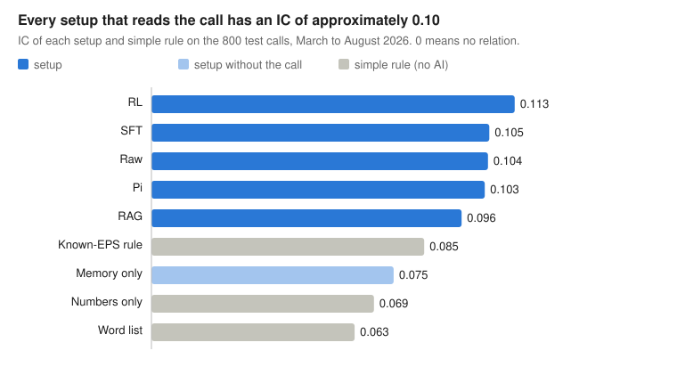

# It Sounds Like the Teacher but Doesn't Trade Like It

*Nityanand Rai · November 13, 2026*

*I spent a week trying to teach a small AI model on my laptop to read earnings calls like a big one. It learned to talk like the big model. It didn't learn to pick better stocks. Here's what I did, what I found, and how I know.*

## Goal

Big AI models like Claude Opus are good at reading a company's earnings call and telling you what's going on. They're also expensive to run on thousands of calls. Small open models are free and run on a laptop, but they're not as sharp.

So I wanted to answer one question: **can a small model learn to read earnings calls well enough to pick stocks, by learning from a big one?**

I also wanted to know which of the usual tricks actually help along the way. People often claim gains from adding documents, letting the model search, fine-tuning it, or training it with rewards. I wanted to test each one honestly, with a check that would catch a fake gain.

## Setup

**The calls.** Every quarter, public companies hold an earnings call: management talks for about an hour, then analysts ask questions. I used calls from smaller US companies, ones whose shares trade between $1M and $50M a day. Fewer professionals listen closely to these, so if a careful reader can find an edge anywhere, it should be here.

**The models.** The student is Qwen3.5-9B, shrunk to 4 bits so it fits in the 18 GB of memory on my MacBook Pro (M3 Pro). The teacher is Claude Opus. Everything except the teacher's answers ran on that one laptop.

**The answer.** For each call, the model sees the transcript with the company name hidden and fills in seven lines:

```
Demand:   up, flat or down        (next two quarters)
Pricing:  up, flat or down
Margins:  up, flat or down
Guidance: raised, held, cut or none
Candor:   direct or evasive
Next EPS: up or down              (next quarter vs a year earlier)
Action:   BUY or AVOID            (hold for 60 trading days)
```

The first five lines are the model's *read* of the call. "Next EPS" is a forecast we can check: next quarter's earnings per share either rise or fall versus a year ago. "Action" is the trade. Because the answer has a fixed form, I can read the model's exact probability for every choice. For example, it might be 62% sure of BUY.

**The sealed test.** This is the rule that keeps me honest. The test calls happened between March and August 2026, after the model came out, so it can't have seen what happened to these stocks. I locked 800 of them away before starting, and nothing looked at their outcomes until the very last step. All tuning used 2025 calls.

**How I score.** One lucky trade proves nothing, so I don't ask "did this BUY make money?" I ask: does the model put the stocks in the right order? The number for that is the *information coefficient* (IC), a rank correlation between how much the model likes each stock and how the stock actually did. "How it did" means its 60-day return minus its sector's return, scaled by how jumpy the stock usually is.

Here's a small example. Five calls land in the same month:

| Call | Model's BUY probability | Model's rank | What happened | Actual rank | Gap d | d² |
| --- | --- | --- | --- | --- | --- | --- |
| A | 0.80 | 1 | +6% | 1 | 0 | 0 |
| B | 0.60 | 2 | −2% | 4 | −2 | 4 |
| C | 0.50 | 3 | +3% | 2 | 1 | 1 |
| D | 0.30 | 4 | +1% | 3 | 1 | 1 |
| E | 0.10 | 5 | −5% | 5 | 0 | 0 |

$$IC = 1 - \frac{6 \sum d^2}{n(n^2 - 1)} = 1 - \frac{6 \times 6}{5 \times 24} = 0.70$$

A perfect order scores 1, a coin flip scores 0, and a backwards order scores −1. I compute this every month and average the results. Real results are much lower than 0.70. Across hundreds of stocks, a steady IC of 0.05 to 0.10 is already useful, because small edges add up over many trades.

The hard part is telling a real gap from luck. To compare two setups, I resample the test calls thousands of times and watch how much the gap between them moves. If the middle 95% of those gaps includes zero, I call the two setups indistinguishable.

## Experiment

I climbed a ladder, one step at a time, with each step building on the last. Every step has a **control**: a deliberately broken version that tells me whether a gain is real or a fluke.

| Step | What it does | The control that keeps it honest |
| --- | --- | --- |
| 1. Raw | The model reads the call and answers. Nothing else. | "Memory only": the same model sees the numbers but not the transcript. |
| 2. RAG | I add related documents from a shared library of past calls and filings, picked by a fixed search. | The same, but with random or shuffled documents. |
| 3. Pi | The model runs its own searches in that library before answering (an agent loop, using the pi agent framework). | The same loop, but given RAG's documents instead of its own picks. |
| 4. SFT | I fine-tune the model on Opus's answers for 800 past calls, so it learns to answer like Opus. | "Placebo": train on Opus's answers shuffled between calls in the same month. |
| 5. RL | Starting from the SFT model, the model tries 4 answers per call and gets nudged toward the ones that score better, over 400 calls. I tried three rewards: getting EPS right, making money on the trade, and both. | The money reward, but with outcomes shuffled, so it rewards noise. |

I also checked something none of the steps above can show: **does the model's action actually follow its reasoning?** I forced the Demand line to say "up" on some runs and "down" on others, then watched whether the BUY probability moved.

And I compared everything against simple rules that need no AI: buy every stock, a word-counting score of the transcript, a rule using only the reported numbers, and a rule that just asks "did earnings beat last year?"

The whole thing took about six days of laptop time and $43 of Opus API calls.

## Results

On the 800 sealed test calls, every AI setup ranked stocks at about 0.10, and no step of the ladder beat the step before it by more than noise.



Reading the transcript does help a little. The same model without the transcript, and the simple rules, all land lower (0.06 to 0.085). RL comes out on top, but by a hair.


Each line in this chart is the gain from one step, with the range it could plausibly fall in. All four ranges cross zero. The RL range is the tightest, and even there the honest summary is "somewhere between slightly worse and slightly better."

The other scores tell a more interesting story:

| Setup | Next-EPS forecast (IC) | Agrees with Opus's read* | Return vs sector after costs, 60 days |
| --- | --- | --- | --- |
| Memory only (no transcript) | 0.253 | — | −0.17% |
| Raw | 0.236 | 66% | +0.36% |
| RAG | 0.229 | 67% | −0.38% |
| Pi | 0.179 | 67% | +0.72% |
| SFT | 0.262 | 70% | +0.50% |
| RL | 0.278 | 71% | +1.06% |
| Known-EPS rule | 0.244 | — | +0.94% |
| Word list | 0.055 | — | +1.42% |
| Buy every call | — | — | −0.68% |

*Measured on 300 separate check calls that Opus also read, not on the test calls. Returns are the average for calls where BUY was more likely, minus a 0.8% round-trip trading cost.

### 1. It learned to sound like Opus, not to trade like Opus

After training, the small model agrees with Opus's read of a call more often (66% before, 71% after), and its earnings forecasts got a bit better. Its stock ranking didn't move.

The controls on the 2025 tuning calls make this sharper. I trained one model on Opus's answers shuffled between calls, so it learned nothing true. It collapsed into never saying BUY, yet it still ranked stocks at 0.099, the same as the RAG model (0.094) on the same 300 calls. The best real SFT model beat it by only 0.04, with a range of −0.07 to +0.17. RL with the money reward scored 0.109; RL with a *shuffled* money reward scored 0.102. Training on noise did about as well as training on the real thing.

So where does the ranking come from? Tiny differences in the model's confidence from call to call, which the base model already had before any training.

### 2. Its actions follow its reasons

When I forced the Demand line to "up" instead of "down", the SFT model's BUY probability went from 0.31 to 0.54. It moved the right way on all 200 calls. After RL the shift was +0.21, the right way on 199 of 200.

That matters: the model isn't writing a story and then ignoring it. The weak spot is the read itself. On the tuning calls, Opus called the EPS direction right 72% of the time and ranked stocks at 0.15, well above anything the small model reached.

### 3. Searching on its own made it worse

Given a search tool, the model made about 4 searches per call and kept about 2 documents. Its earnings forecasts got worse: 0.179 on the test, against 0.229 for fixed RAG.

To find out why, I ran the same agent loop but handed it RAG's documents instead of its own picks. On 200 shared calls, the forecast went back up to 0.22 (own picks: 0.14; RAG: 0.28). The loop is fine. The small model is just bad at choosing what to read.

### 4. No money to be made yet

Returns after costs ranged from −0.68% to +1.42% over 60 days. The best one came from a word-counting rule with no AI at all. Numbers this small and this scattered are noise.

## Conclusions

**Teaching a small model to copy a big one made it sound smarter, not invest better.** The student picked up Opus's way of reading a call, and its earnings forecasts improved a little. None of that showed up in which stocks it liked.

A few things I'd take away:

- **Always run a placebo.** If I'd skipped the shuffled-label and shuffled-reward controls, I'd have reported that SFT and RL "work." In this experiment, gains that looked real on one batch of calls disappeared on the next, and the controls explained why.
- **Check that the reasoning drives the decision.** Here it does, so the next thing to fix is clear: better reads, not a better trading rule.
- **Don't let a small model choose its own sources** unless you've checked its choices. Fixed retrieval beat its own searching.
- **Simple rules are a high bar.** A one-line "did earnings beat last year?" rule got within about 0.02 of the best model.

**What I wouldn't claim yet.** 800 test calls is not a lot. "No difference" here means "no difference I can see at this size," not "proven to be zero." I also tested one small model, one holding period, and one slice of the market.

**Running it on a laptop.** Three things broke along the way. A learning rate that was too high wrecked one training run. One call with a missing price outcome crashed RL with a NaN. And closing the lid on battery put the Mac to sleep for an hour, which no setting could prevent. All of it is logged with the fixes.

**What's next.** Two experiments would turn this into a paper:

1. Score the finished models on the second sealed test set (about 1,750 calls I haven't touched) to tighten those ranges.
2. Give the small model Opus's read and let it make only the trade. If its ranking climbs toward Opus's 0.15, that settles whether the read is the bottleneck.

---

## Files in this folder

| Path | What it holds |
| --- | --- |
| `results/results.csv` | Final scores on the 800 sealed test calls, one row per setup or baseline |
| `results/findings.csv` | The four paired comparisons (gain and 95% range) |
| `results/faithfulness.csv` | The forced-Demand test: how far the BUY probability moved |
| `results/dev_2025_all_arms.csv` | Every arm and control on the 2025 tuning calls, with 95% ranges |
| `results/dev_sft_arms.csv`, `dev_rl_arms.csv`, `dev_rag_vs_pi.csv` | The tuning-call tables used to pick the best SFT, RL and retrieval setup |
| `results/README.md` | What every column means |
| `figures/*.svg` | The two charts above |
| `make_figures.py` | Redraws the charts from `results/` (Python 3, no extra packages) |

To redraw the figures: `python3 blog/2026-11-small-model-earnings-calls/make_figures.py`

The pipeline that produced these numbers is in `scripts/paper/`, and every fix made during the runs is in `docs/FIXES.md`. To check these tables yourself, run `bash reproduce/rescore.sh` from the repo root.
